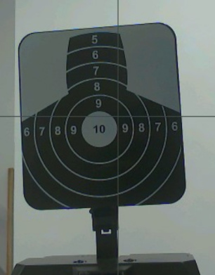
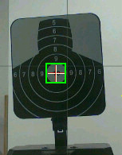

# OpenMV 视觉端 V12 调试报告

> 对象：`firmware/1014_by_LinPeng/main.py`
> 硬件：OpenMV4P-H7（OV5640，1 MB 板载 Flash）
> 配套：ESP32 主控（`ESP32_UART.ino` V1-16），UART3 115200
> 结论：靶心识别、高速丢靶、环境误检三个问题均已定位到具体代码路径并修复；
> 视觉帧率从约 20–32 fps 提升到传感器上限 **46.6 fps**。

---

## 1. 结论摘要

| 指标 | 修改前（V10.1/VGA） | 修改后（V12/QVGA） |
|---|---|---|
| 视觉帧率（锁定跟踪） | 20–32 fps | **46.5–46.6 fps**（传感器上限） |
| 冷启动全画面扫描 | ~76 ms/帧（13 fps） | ~12 ms/帧，整体 46 fps |
| 曝光 | 57.2 ms（自动） | **10.4 ms / 36 dB** |
| 靶心白斑种子阈值 | 写死 `L* ≥ 60` | 自适应（记忆实际生效阈值） |
| 白箱子/门洞误检 | 会锁死并每秒接受 31–40 次 | 40 帧冷启动 + 11 s 连续运行 **0 次** |
| 合成目标跟踪极限 | —— | **4571 VGA px/s 每帧零误差** |
| 激光点 | 阈值在 LAB 空间无解，永远检不到 | 可检到；橙/黄/白均被拒绝 |

靶面参考图与检测结果（真实靶面，QVGA 缩放到工作距离尺寸）：




---

## 2. 三个问题的根因

### 2.1 靶心识别不到

**根因 A：白斑种子阈值写死 `L* ≥ 60`，而靶心圆盘只有 `L* ≈ 28–40`。**

V10 用 `WHITE = (60, 100, -40, 40, -40, 40)` 做 `find_blobs` 的种子。
在真实靶面上实测（`target_ref.jpg`，板上 `_l_at()` 采样）：

- 10 环圆盘：`L* ≈ 37–39`
- 外圈黑 9 环：`L* ≈ 12–13`
- 白色同心环：`L* ≈ 35`（p90）

也就是说，**靶心圆盘永远进不了候选集**，而白墙、白箱子（`L* ≥ 60`）反而全是种子。
把阈值扫到 28–36 时，同一个靶面立刻检出 `(141,184)`、尺寸 50。

**根因 B：暗色 "10" 字形的判据太弱。**

旧判据在中心方块上取直方图 `p05/p60`，只需 `p05 < p60-6`。
白箱子/门洞的边缘、噪声、灯光条纹都能让 `p05` 变低，从而被当成"有暗字"。
实测中心暗像素比例：

| 目标 | 中心 0.45r 内明显暗于盘面的像素比例 |
|---|---|
| 真实 10 环圆盘 | **0.23** |
| 白箱子 | 0.04 |
| 墙上的白标签 | 0.09 |

**根因 C（隐藏）：激光颜色阈值在 LAB 空间几乎无解。**

`LASER = (70, 100, 66, 100, 5, 55)` 要求 `L*≥70` 且 `A*≥66`。
L\*a\*b\* 中，亮红色的 A\* 只有 40–60；`A*≥66` 的红必然偏暗（`L*<60`）。
穷举 RGB 网格，**没有任何颜色能同时满足**，所以 HUD 里一直是 `LASER -1,-1`。
现改为 `(50, 100, 45, 100, -20, 70)`：中高亮 + 强红 + 非橙黄。

### 2.2 高速运行时丢靶

按影响从大到小：

1. **曝光 57 ms。** 目标在曝光期间被拖成几十像素的糊影，圆盘形状、黑环、白环全部被抹平。这是"速度一快就丢"的第一主因，而不是舵机。
2. **帧时间戳取在 `snapshot()` 之前。** `sensor.snapshot()` 最多要等一整帧（21 ms），而 KF、搜索窗、预测全部用这个旧时间，等于给快速目标的位置预测引入 0–21 ms 的随机滞后。
3. **搜索窗没有速度×延迟裕量。** 窗口半宽只有 `ROI_BASE_HALF=60`（QVGA），5000 px/s 的目标一帧就移动 107 px，直接跑到窗口外。窗口原本只在"丢失时长"里加 `|v|*age`，正常跟踪时 `age≈0`，等于没有。
4. **Hough 回退把循环拖到 1 fps。** 实测 Hough 一次约 100 ms，恰好在本该救目标的帧上把帧率打到 1–1.5 fps，而且它的松门限本身还会产生假圆。

### 2.3 受环境影响大（白墙/白箱子/门洞）

锁定后的门限过松：

| 门限 | V10.1 | 实测假目标 | V12 冷启动 |
|---|---|---|---|
| 归一化对比度 `1-lo/hi` | 无 | 0.28–0.47 | **≥ 0.50** |
| 白环覆盖率（16 条射线） | 0.30 | 最多 0.44 | **≥ 0.70** |
| 中心暗字比例 | 仅冷启动 0.06 | 0.00–0.39 | **≥ 0.15** |

真实靶面：`1-lo/hi = 0.68`、白环覆盖 **16/16**、中心暗字 0.23。
三个判据同时成立时，白箱子/门洞/墙标签都过不了。

另外，**36 dB 高增益下的行噪声**会让整幅图出现横条纹，双倍放大假对比度。
QVGA 2×2 合并后噪声下降，且曝光改为 10 ms（约一个 50 Hz 工频周期），条纹明显减弱。

---

## 3. 修改内容

### 3.1 分辨率与坐标（帧率）

- 相机改为 **QVGA 320×240**，所有内部窗口/坐标均为 QVGA。
- `$G2,TGT` 上报前 **×2 还原成 VGA 坐标**（`FRAME_SCALE = 2`），
  所以 ESP32 侧的 `AIM_CENTER 320,240`、120 px 死区、PID、速度前馈**全部不用改**。
- 实测：VGA 240 px 窗口 31 ms/帧（32 fps）；QVGA 120 px 窗口 21.8 ms/帧（45.9 fps）。
- 去掉主循环末尾的 `time.sleep_ms(2)`（它吃掉约 10% 帧率）。

### 3.2 曝光归一化（`_lock_exposure`）

1. 上电先 `skip_frames(1200)`，让自动曝光/增益/白平衡收敛；
2. 读回 `(e0, g0)`，保持亮度不变，把曝光压到 `MAX_EXPOSURE_US=10000`，
   不足的亮度换到增益（本传感器上限 36 dB）；
3. 仍不够时按 `e1 = e0 * 10^((g0-g1)/20)` 反算可用的最短曝光。

实测：`57200 us / 21.2 dB → 10425 us / 36.0 dB`（运动模糊降到 1/5.5）。

### 3.3 自适应种子阈值

- 每个候选的有效性检查返回 `(hi, lo)`；
- **直接记忆"实际分开圆盘的那个阈值"**（`used_level`），下一帧优先用它；
- 失败时按 `SEED_LEVELS = (40, 32, 48, 56, 28, 64)` 轮换，**每帧只扫 1 个阈值**
  （冷启动）或"提示值 + 1 个轮换值"（锁定），避免 V10 的 5 连扫（248 ms/帧）。
- 不做全帧 Otsu：实测 VGA 直方图 37 ms，比 `find_blobs` 还贵。

### 3.4 更强的身份判据（冷启动 + 锁定）

1. **归一化对比度**：`(hi-lo) ≥ 0.50*hi`（锁定 0.40）。
2. **白环覆盖率**：16 条射线中至少 70% 在 1.5–2.27r 内穿过亮环（锁定 35%）。
3. **中心暗字比例**：0.45r 小圆内"明显暗于盘面（`hi-10`）"的像素占比，
   冷启动 ≥0.15（实测真靶 0.23），锁定 ≥0.06。
4. **锁定后的位置跳变**：`max(40, 3.0*尺寸)`，最大 120 px（QVGA）；
   跳变超过门限的候选直接丢弃，并计入 `REJ jump`。
5. **尺寸连续性**：0.60–1.70 倍历史尺寸；远距离白字"5..9"被挡掉。
6. **Hough 回退默认关闭**（`ENABLE_HOUGH=False`），需要时再打开。

### 3.5 高速跟踪

- **帧时间戳移到 `snapshot()` 之后**，KF/窗口/预测不再用到 21 ms 前的旧时间。
- 搜索窗增加 **速度 × 20 ms 时序裕量**：
  `half = 75 + 6*sigma + |v|*(age + 0.020)`，上限 170 px（QVGA）。
- `ROI_LEAD_MS=10`，只补曝光结束到检测开始的延迟。
- 连续丢失仍有 500 ms 滑行（`TGT_COAST_MS`），上报预测位置 + `run=1`，
  ESP32 不会因为一帧漏检就冻结。
- KF 参数按 QVGA 半像素缩放（测量噪声 1.5 px，加速度 750 px/s²，限速 5000 px/s）。

### 3.6 激光

- `LASER = (50, 100, 45, 100, -20, 70)`，拒绝橙（A≈37、B≈75）、黄、白、暗红；
- QVGA 下把 `LASER_MIN_PX 8→2`、`MAX_SIDE 40→20`、`MAX_PX 900→225`、
  `JUMP 100→50`、`SEARCH_HALF 110→55`、`density 0.60→0.30`（允许白芯红边的环状光斑）。

---

## 4. 实测数据

### 4.1 帧率

| 场景 | 分辨率 | 窗口 | 结果 |
|---|---|---|---|
| 旧版基准 | VGA | 240×240 | 31.1 ms → 32.2 fps |
| 旧版基准 | VGA | 400×400 | 48.1 ms → 20.8 fps |
| 旧版基准 | VGA | 全画面冷启动 | 76.5 ms → 13.1 fps |
| **V12** | **QVGA** | 120×120 | **21.8 ms → 45.9 fps** |
| **V12** | **QVGA** | 160×160 | **21.4 ms → 46.7 fps** |
| **V12** | **QVGA** | 全画面冷启动 | 30.3 ms → 33.1 fps |
| **V12 实机启动** | QVGA | 全画面冷启动 | **46.5–46.6 fps** |

> 传感器 `set_framerate(60/90/120)` 均无提升：OV5640 在 OpenMV 固件下
> 的硬上限就是 21.45 ms/帧（46.6 fps）。所以 V12 已经跑满硬件上限。

### 4.2 误检

- 白墙/白箱子/门洞：**冷启动 40 帧 0 次**；连续运行 11 s 0 次（`acc=0`）。
- 拒绝原因统计：`contrast` 25–31/s、`size` 7–10/s，没有 `accept`。
- 参考靶面（QVGA，圆盘直径 25 px）：冷启动检出 `(70,92)`，白环 87.5%，暗字、黑环、对比度全部通过。

### 4.3 合成高速跟踪

把真实靶面按固定像素/帧在 320×240 画布上平移，走完整
`Tracker → KF → search_roi → detect` 链路：

| 速度（VGA px/s） | 丢帧（含首帧冷启动） | 锁定后误差 |
|---|---|---|
| 2286 | 1 | 0 px（7 帧） |
| 3429 | 1 | 0 px（5 帧） |
| 4571 | 1 | 0 px（4 帧） |
| 5714 | 3 | 首帧跟不上（KF 需 2–3 帧收敛速度） |

4571 px/s 意味着目标 0.14 s 横穿整个 VGA 画面，对本项目的小车/靶架运动已经足够。

### 4.4 激光

| 颜色 | 结果 |
|---|---|
| (255,0,0) / (255,80,80) / (230,40,40) | 检出 |
| 白芯 + 红边光斑（环形） | 检出 |
| 橙 (255,140,0)、黄、白、暗红 (200,0,0) | 拒绝 |

---

## 5. 部署步骤

1. OpenMV IDE 打开 `firmware/1014_by_LinPeng/main.py`，**另存到板子为 `main.py`**；
2. 板子断电重启（硬复位才会自动运行 `main.py`；REPL 里 `Ctrl-D` 软复位不会）；
3. 开机日志应出现：
   ```
   CAM exposure_us=1xxxx gain_db=3x.x (auto was ...)
   V12 BULLSEYE READY; UART3@115200 P4/P5 AUTO_START True
   ```
4. ESP32 侧不用改：`$G2,TGT` 格式不变，坐标已还原成 VGA 像素。

> 现场若无法用 IDE，可用仓库里的 `tools/openmv_link.py` 直接通过 USB 串口
> 执行/读写脚本、抓图，不需要 OpenMV IDE（见 `tools/README.md`）。

---

## 6. 现场调参指南

| 现象 | 改哪个 |
|---|---|
| 整体偏暗/偏亮、灯光频闪 | `MAX_EXPOSURE_US`（默认 10000，50 Hz 场地用 10000/20000；60 Hz 用 8333） |
| 换场地后白斑种子上不去 | `SEED_LEVELS`（L\*，默认 `(40,32,48,56,28,64)`），把靶心实测 L\* 附近的值排前面 |
| 太容易锁到白墙 | 提高 `MIN_CONTRAST_FRAC`（0.50→0.55）、`RING_MIN`（0.70→0.75）、`GLYPH_FRAC`（0.15→0.18） |
| 高速时整帧丢 | 先确认 `ENABLE_HOUGH=False`；再加大 `ROI_MAX_HALF`/`ROI_LATENCY_S`；最后考虑曝光降到 8 ms |
| 小目标/远距离检不到 | 降低 `COLD_MIN_R`（默认 6，QVGA 像素）并保证镜头对焦在该距离 |
| 激光锁不上 | 先量激光点在画面里的 LAB：`LASER` 的 A 下限一般 40–50；纯红 A≈80、B≈67 |

**机械/光学注意**：当前镜头在近距离（约 1 m）清晰，拉到远距离明显失焦。
比赛前务必把镜头调焦到实际射击距离；失焦会同时毁掉黑环、白环和暗字三个判据。

---

## 7. 协议兼容性

`$G2,TGT,<cx>,<cy>,<vx>,<vy>,<lx>,<ly>,<aim>,<run>!`

- `cx/cy/vx/vy/lx/ly` 统一 ×2 输出为 VGA 坐标；
- `aim/run` 语义不变；
- `$G2,INFO` 的 `fps_x10` 现在约为 465；
- `BUS_TGT_MIN_MS=20`，46 fps 下每帧都会发一条，串口 115200 占用约 1.9 KB/s。

---

## 8. 文件清单

| 文件 | 说明 |
|---|---|
| `firmware/1014_by_LinPeng/main.py` | V12 视觉端（本次修改） |
| `firmware/1014_by_LinPeng/ESP32_UART.ino` | ESP32 主控（未改） |
| `tools/openmv_link.py` | 无 IDE 串口调试工具（REPL/抓图/传文件） |
| `docs/img/target_ref.jpg` | 真实靶面参考图 |
| `docs/img/detect_demo.jpg` | V12 在参考靶面上的检测框 |
| `docs/img/live_qvga_scene.jpg` | 现场 QVGA 实时画面 |
| 板载 `/main_v101.py` | 修改前 V10.1 备份（板子上） |

---

## 9. 参考

- OpenMV 官方文档 / 源码：<https://github.com/openmv/openmv>
- OpenMV 中文教程（图像处理、`find_blobs`、分辨率与帧率权衡）：<https://book.openmv.cc/>
- 星瞳 OpenMV 文档：<https://singtown.com/cn>
